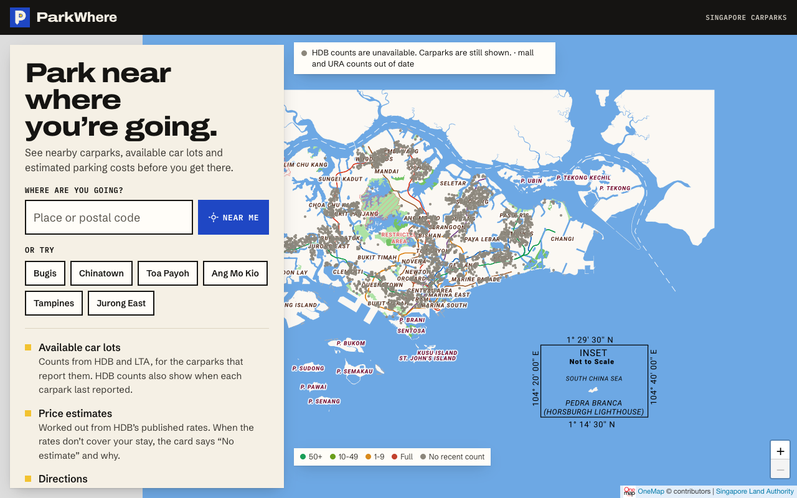
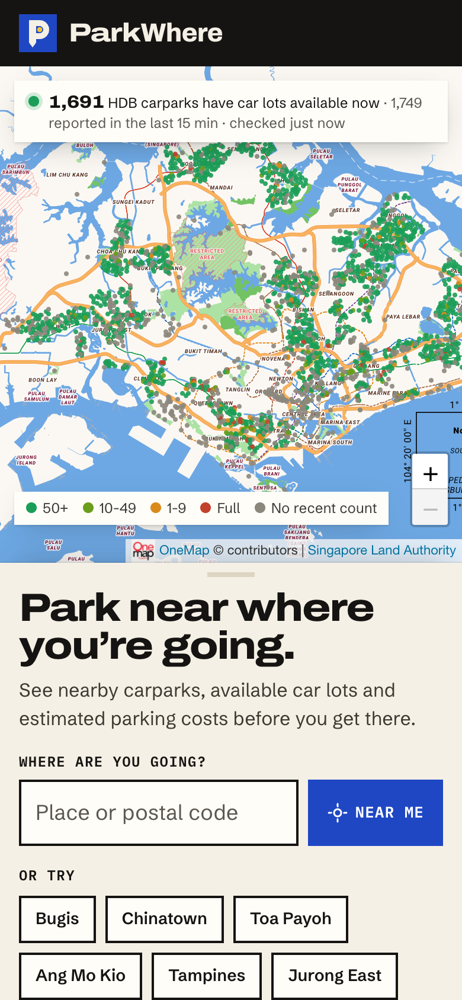
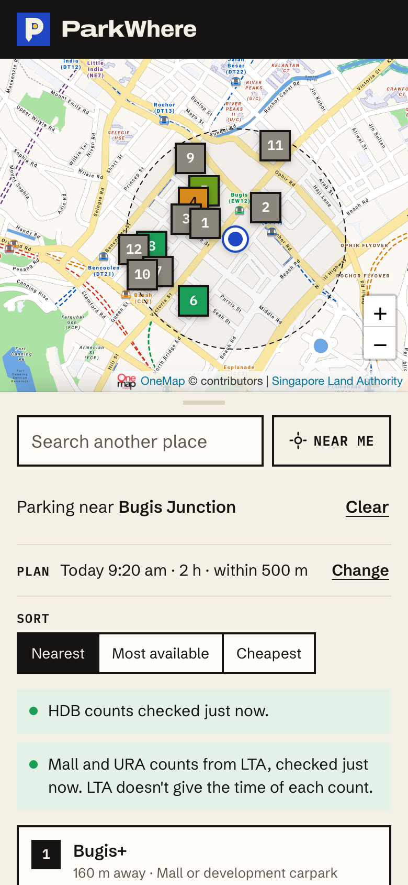
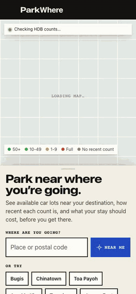
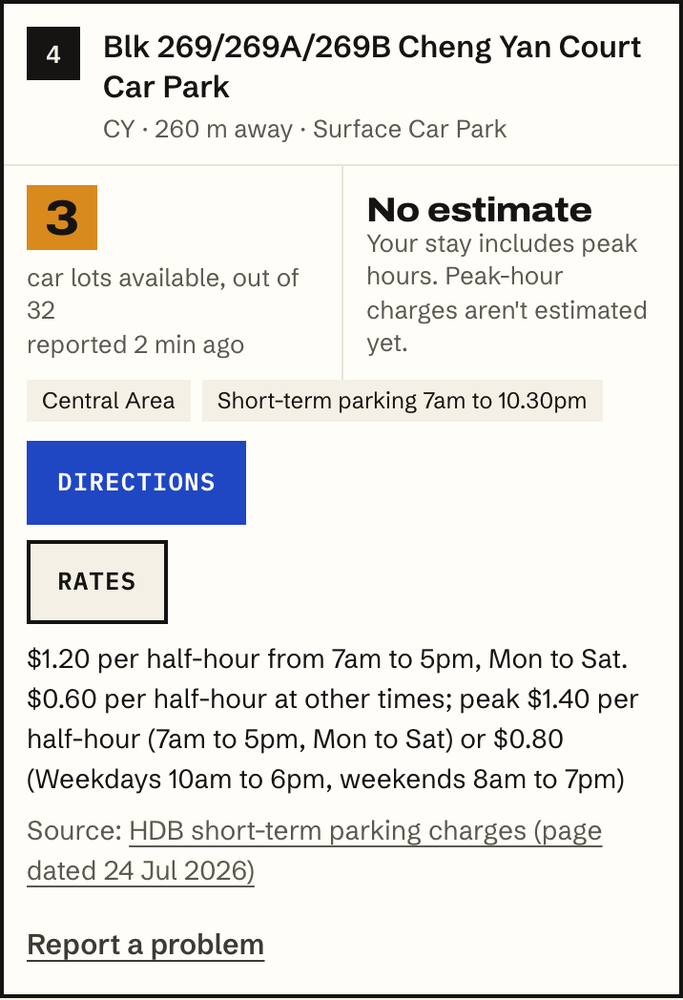
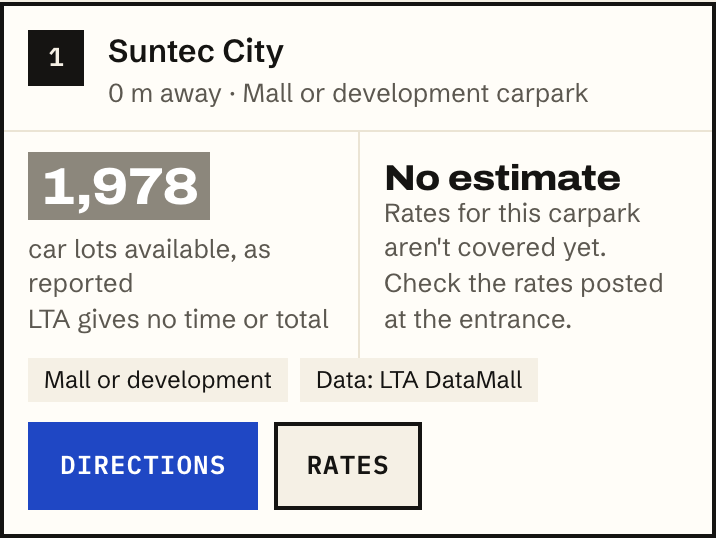
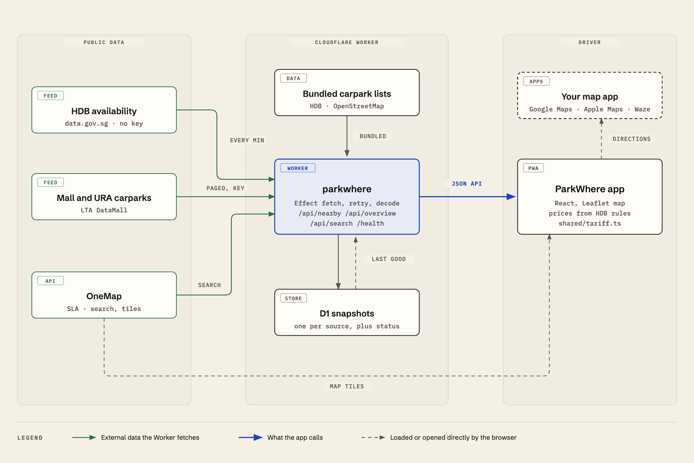
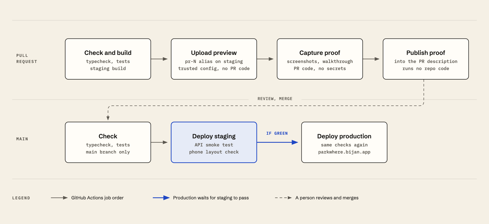

<p align="center">
  
</p>

<h1 align="center">ParkWhere</h1>

<p align="center">
  Singapore parking finder.<br>
  See carparks near where you're going, available car lots and estimated parking costs.
</p>

<p align="center">
  <a href="https://parkwhere.bijan.app"></a>
  <a href="https://github.com/najibninaba/parkwhere/actions/workflows/deploy.yml"></a>
  <a href="LICENSE"></a>
  <a href="https://data.gov.sg/open-data-licence"></a>
  <br>
  
  
  
  
</p>

<p align="center">
  
</p>

<p align="center">
  
  &nbsp;
  
  &nbsp;
  
</p>

## What it does

- **Shows carparks on a map.** Every HDB carpark, the mall and URA carparks that report counts to LTA, and carparks mapped on OpenStreetMap: public ones such as the zoo's, and ones at malls, venues and parks. Dots are coloured by how many car lots are available. OpenStreetMap carparks have no count, so their dots are grey.
- **Says how recent each count is.** HDB counts show when the carpark last reported. LTA counts have no time, so they're shown as reported. Only counts from the last 15 minutes are coloured. Older counts are grey, with their age, and a count is never shown as 0 when it's unknown.
- **Estimates parking costs at HDB carparks.** Prices are worked out from HDB's published rates, including per-minute charging, the 15-minute grace period, Central Area hours, night and day caps and free parking on Sundays and public holidays. When the rules don't cover a stay, the card says "No estimate" and why, and shows the published rate. Mall, URA and OpenStreetMap carparks say "No estimate".
- **Hands off to your map app.** Directions open in Google Maps, Apple Maps or Waze at the carpark's mapped location, or at its entrance when OpenStreetMap maps one.

<p align="center">
  
  &nbsp;
  
</p>

## How it works

<p align="center">
  
</p>

One Cloudflare Worker serves the web app and a small JSON API:

| Route | Returns |
|---|---|
| `GET /api/nearby?lat=&lng=&radius=300\|500\|1000` | Carparks near a point, with car lot counts and the status of each feed |
| `GET /api/overview` | Every carpark as a coloured dot, for the landing map |
| `GET /api/search?q=` | Places from OneMap, or HDB carpark addresses when OneMap isn't configured |
| `GET /health` | 200 when the HDB feed is live, otherwise 503. It also reports LTA. |

### Data sources

- **HDB car lot counts** come from data.gov.sg's [Carpark Availability](https://data.gov.sg/datasets/d_ca933a644e55d34fe21f28b8052fac63/view). No key is needed.
  - The Worker keeps the last good copy in D1. When a request finds it over a minute old, the Worker refreshes it, in the background if the copy is under 5 minutes old.
  - Only one refresh runs at a time across all instances. Short failures are retried twice.
  - The feed sometimes splits one carpark into several records, one per lot type. Records are matched by carpark and lot type and are never added together.
- **Mall and URA car lot counts** come from LTA DataMall's [CarParkAvailabilityv2](https://datamall.lta.gov.sg/content/datamall/en/dynamic-data.html) (`LTA_DATAMALL_ACCOUNT_KEY`).
  - They have their own last good copy, so either feed can fail without affecting the other.
  - LTA's HDB rows are dropped in favour of data.gov.sg's: all 1,997 matched by carpark number, and data.gov.sg gives times and totals.
  - LTA gives no time and no total, so these counts are shown "as reported", drawn grey and never priced.
- **Carpark locations and details** come from the [HDB Carpark Information](https://data.gov.sg/datasets/d_23f946fa557947f93a8043bbef41dd09/view) registry, bundled as `worker/registry.json` and converted from SVY21. Refresh it with `pnpm registry`.
- **Public carparks without counts** come from [OpenStreetMap](https://www.openstreetmap.org/copyright), bundled as `worker/osm-carparks.json`.
  - Only carparks and entrances tagged as open to the public, customers or with permission are kept. A carpark with no access tag is left out, because it's often a condo or office carpark.
  - Street parking, HDB-run carparks, and parking for heavy vehicles, loading, drop-off or season holders are left out.
  - So that no carpark is listed twice, one is also left out when it's within 80 m of an HDB, LTA or URA carpark, has the same name as an LTA or URA carpark within 300 m, or is unnamed and within 250 m of one. A carpark that OpenStreetMap maps more than once (as a point, an area and entrances) is listed once.
  - They have no count and no price. Directions go to a mapped entrance when there is one.
- **Carparks at public places** also come from OpenStreetMap, in the same file. Many malls, venues and parks, such as Jewel and Singapore Expo, have their carpark mapped with no access tag. ParkWhere lists one carpark for such a place, as "Carpark mapped at Singapore Expo", with "Visitor access not confirmed". It never says the carpark is public.
  - Places are named areas: malls, conference and exhibition centres, attractions, museums, galleries, zoos, theme parks, aquariums and airport terminals, where a carpark area or entrance is mapped inside the outline or within 30 m of it, or a carpark named after the place is within 300 m. Parks, gardens, nature reserves, sports centres, stadiums and water parks count only a carpark area inside the outline.
  - Hospitals, clinics, schools and universities, blocks of flats with shops below, neighbourhoods, private places, park connectors and generic names such as "Playground" are left out, as are places under construction or closed.
  - The same filters as public carparks apply to the mapped carpark, and also to anything for buses or goods vehicles, anything described as for residents or staff, exits and service entrances. An entrance just outside a place that is closer to another building is taken to be that building's.
  - One carpark makes one entry: when places share it, the more specific one keeps it. An entry is dropped only when it's HDB-run, within 80 m of an HDB carpark, already shown as a public carpark, within 30 m of an LTA or URA carpark, or an LTA or URA carpark with the place's name is within 300 m.
  - Refresh with `pnpm osm`, which needs [osmium-tool](https://osmcode.org/osmium-tool/) and caches Geofabrik's 250 MB Malaysia, Singapore and Brunei extract in `.cache/osm/`.
- **Place search and map tiles** come from [OneMap](https://www.onemap.gov.sg/) (Singapore Land Authority). Search needs `ONEMAP_EMAIL` and `ONEMAP_PASSWORD`, and the token is cached in D1.
- **Prices** follow HDB's [short-term parking charges](https://www.hdb.gov.sg/parking/other-parking-matters/shortterm-parking/shortterm-parking-charges) and MOM's public holidays for 2026 and 2027 (`shared/tariff.ts`, `shared/holidays.ts`).

## Run it locally

You need Node.js 24 or later, pnpm 10 and Google Chrome (for the phone checks).

```sh
pnpm install
pnpm exec wrangler d1 migrations apply parkwhere-production --local
pnpm dev                     # http://localhost:5173
```

The app runs without keys. To try OneMap search and mall carparks, put your own keys in `.dev.vars` (git ignores it): `ONEMAP_EMAIL`, `ONEMAP_PASSWORD`, `LTA_DATAMALL_ACCOUNT_KEY`.

| Command | What it does |
|---|---|
| `pnpm check` | Typecheck, tests and production build |
| `pnpm check:mobile [url]` | Phone check at 320, 390 and 412 px: no sideways overflow, tap targets of 40 px or more, no numbers cut off |
| `pnpm media [url]` | Regenerates the screenshots, walkthrough and diagram images in `docs/media` |
| `pnpm proof <url>` | Captures proof from a deployed build, as CI does for each PR |
| `pnpm registry` | Refreshes the bundled HDB carpark registry |
| `pnpm osm [--refresh]` | Refreshes the bundled OpenStreetMap carparks (needs osmium-tool) |
| `pnpm stats [--days 7 \| --month YYYY-MM --write]` | Reports usage counts; `--write` saves a monthly summary to `docs/stats/` |

## Environments and deploys

<p align="center">
  
</p>

| | Production | Staging | Pull request previews |
|---|---|---|---|
| URL | https://parkwhere.bijan.app | https://parkwhere-staging.bijan.app | `https://pr-<n>-parkwhere-staging.<subdomain>.workers.dev` |
| Worker | `parkwhere` | `parkwhere-staging` | preview versions of `parkwhere-staging` |
| D1 | `parkwhere-production` | `parkwhere-staging` | staging's |

- **Every pull request** is checked and built, uploaded as a preview, and captured as proof. The proof is phone and desktop screenshots, a walkthrough and a table of checks, written into the top of its description. A separate check fails the pull request if *What changed*, *Why*, *Risk assessment* or *How it was tested* is empty.
- **Every merge to `main`** deploys to staging and checks it. It deploys to production only if staging passes.
- **The preview workflow keeps secrets away from pull request code.**
  - The job with the Cloudflare token runs no code from the pull request and deploys with a config it writes itself.
  - The capture job runs the pull request's code with no secrets.
  - The publish job runs no repository code.
  - Pull requests from forks get no secrets and no preview.

### Deploy your own

1. Create the D1 databases and set their IDs in `wrangler.jsonc`. Change the routes to your own domain.
2. Apply migrations: `pnpm exec wrangler d1 migrations apply <database> --remote` (add `--env staging` for staging). CI never applies migrations, so run this before merging a change that adds one.
3. Add the repository secrets `CLOUDFLARE_API_TOKEN` and `CLOUDFLARE_ACCOUNT_ID`. The token needs:
   - Account: Workers Scripts Edit, D1 Read, Account Settings Read
   - Zone (your domain only): Workers Routes Edit, Zone Read
4. Set the Worker secrets you want with `pnpm exec wrangler secret put <NAME>`. For staging, use `pnpm exec wrangler versions secret put <NAME> --env staging`, because previews leave staging's latest version undeployed.
5. Update the staging database ID and the `workers.dev` subdomain in `.github/workflows/preview.yml`.

You can also deploy by hand with `pnpm run deploy:staging` and `pnpm run deploy`. Roll back with `pnpm exec wrangler rollback` (add `--env staging` for staging).

## Privacy and usage counts

ParkWhere is free, so it counts a few things to judge whether it's useful: page loads, destination lookups (how the destination was chosen and what was found), place searches (the number of results only), directions opened, and server errors. Each count can carry the device type (phone or desktop), whether ParkWhere was opened as an installed app, the country Cloudflare reports, and the referring site's name. Reloading a page doesn't count as a new visit or lookup. The counts go to [Workers Analytics Engine](https://developers.cloudflare.com/analytics/analytics-engine/), which keeps them for three months; `pnpm stats --month YYYY-MM --write` keeps a monthly summary in `docs/stats/`.

- **Never recorded:** cookies, IDs, IP addresses, search text, exact locations, or anything that links one visit to another. For referrers, only the referring site's name is kept (such as `google.com`), never the page or a personal subdomain.
- **Rough area only for gaps:** when a place you searched for, picked or panned to has no carpark nearby, its area is recorded at about 2 km across, so coverage can be improved. Near me and shared links never record an area.
- **Kept on your device:** nothing, unless you turn counting off for your browser by visiting `?nostats` (and back on with `?stats`).
- **Not counted:** browsers that send Global Privacy Control or Do Not Track, automated browsers (including ParkWhere's own checks), bots and pull request previews. Staging writes to a separate dataset.
- **Logs:** the Worker's request logs leave out query strings, which hold coordinates and search text. Cloudflare, which hosts ParkWhere, handles visitors' IP addresses to serve the site; ParkWhere doesn't store them.

## Not covered yet

- Prices for mall and URA carparks. LTA's only rates dataset is free text from 2018, and URA's rates API needs a separate URA key.
- Price estimates for coupon carparks, stays during peak-hour windows, and Central Area rates on weekday public holidays.
- Carparks that report to neither HDB nor LTA, unless OpenStreetMap tags them as public or maps them at a public place. Who may park at a place's carpark isn't checked: the card says visitor access isn't confirmed. Places mapped only as a point or as land use (such as Paya Lebar Quarter), places whose carpark is mapped only as a point (such as Sengkang Grand Mall), and hospitals are left out.
- Walking distances and verified entrances. Distances are in a straight line. Directions go to the carpark's mapped point, or to an entrance mapped on OpenStreetMap, and ParkWhere hasn't checked either.
- Public holidays after 2027. Add them to `shared/holidays.ts` when MOM publishes them.
- Dark mode.

## Contributing

Issues and pull requests are welcome. Please read [CONTRIBUTING.md](CONTRIBUTING.md), [AGENTS.md](AGENTS.md) (data rules and layout) and [DESIGN.md](DESIGN.md) (visual system) first. Report security problems privately, as described in [SECURITY.md](SECURITY.md). This project follows a [code of conduct](CODE_OF_CONDUCT.md).

## Sources and licences

The code is under the [MIT License](LICENSE).

ParkWhere contains information from Carpark Availability and HDB Carpark Information, accessed from data.gov.sg, and from Car Park Availability, accessed from LTA DataMall. All of it is made available under the terms of the [Singapore Open Data Licence version 1.0](https://data.gov.sg/open-data-licence). The fixtures in `fixtures/` are trimmed copies of that data, used for tests.

Carpark and place locations from OpenStreetMap are © [OpenStreetMap contributors](https://www.openstreetmap.org/copyright). `worker/osm-carparks.json`, `fixtures/osm-parking.sample.json` and `fixtures/osm-places.sample.json` are derived from OpenStreetMap and are available under the [Open Database Licence 1.0](https://opendatacommons.org/licenses/odbl/1-0/), not the MIT License.

LTA's API terms allow commercial use with attribution and require keys to be kept on the server. ParkWhere keeps its key on the server and keeps only the last minute's copy of the data.

Maps are © OneMap contributors and the Singapore Land Authority. Fonts are Archivo, Schibsted Grotesk, IBM Plex Mono and Libre Caslon Text, all under the SIL Open Font License.

ParkWhere is an independent project. It isn't affiliated with or endorsed by HDB, LTA, URA, SLA or GovTech.

ParkWhere is a [najibninaba](https://najibninaba.com) project. © 2026 Najib Ninaba.
